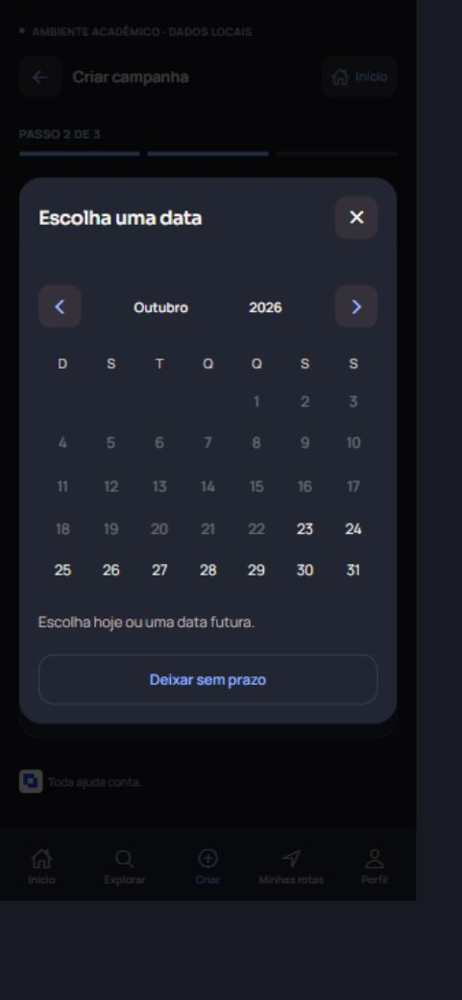
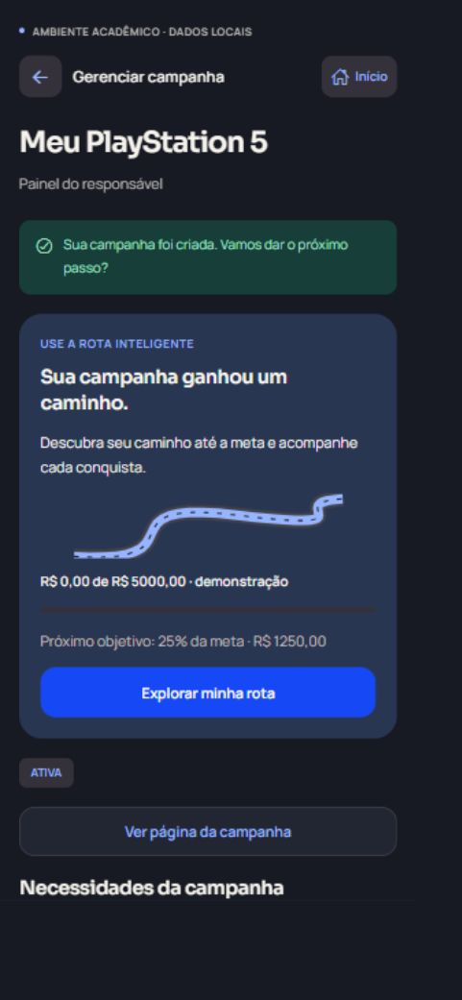
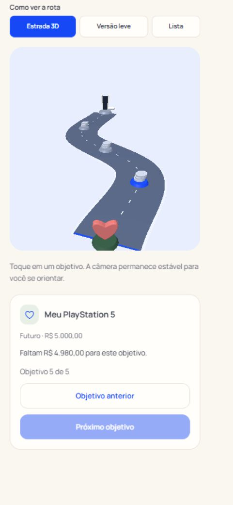

# Experiência simplificada do Soma

> Registro da versão 6d63efd e anteriores. A integração atual preserva a experiência descrita e atualiza os contratos de API, publicação, privacidade, urgência e conciliação: [guia SOMA 2.0](SOMA-2.md) e [validação atual](SOMA-2-VALIDACAO.md).

Refinamento sobre a versão `dfd8eb3`, na branch existente `mudancas-jf`. Preserva Expo/React Native, Node HTTP, MySQL, identidade azul royal, temas, tipografia, sessões, permissões, classificação de urgência, pagamentos de teste e rateio dos anúncios. Nenhuma tabela foi recriada ou apagada. Os commits são integrados à `main` depois das validações, sem force push.

## Criar uma campanha

O fluxo principal de novas vaquinhas tem três etapas:

1. **Qual é o seu objetivo?** Nome, história e categoria.
2. **Quanto você precisa?** Meta financeira, calendário opcional e imagem opcional. Localização geral e UF ficam em uma seção adicional, sem endereço pessoal.
3. **Tudo pronto para começar?** Prévia, resumo e criação. A natureza demonstrativa dos pagamentos é apresentada antes da publicação.

Voltar conserva nome, história, categoria, meta, data e imagem na sessão de edição. O botão Voltar do Android também retorna uma etapa. O rascunho não é anunciado como salvo após fechar/recarregar o aplicativo. Ele é limpo somente depois da confirmação de criação pelo servidor. Enquanto a foto é preparada, a continuação fica desabilitada para evitar publicar antes de ela terminar.

O calendário usa os componentes nativos já adotados, com escolha por toque de dia, mês e ano, grade mensal, navegação entre meses e anos, formato DD/MM/AAAA e botão para deixar sem prazo. No novo fluxo, dias passados são desabilitados; edições podem preservar datas passadas do histórico. O servidor continua recusando datas impossíveis. A data e a região são opcionais na campanha regular; isso não concede urgência verificada e não muda os critérios de elegibilidade do fundo, que continuam exigindo prazo válido quando necessário.

Imagens são preparadas localmente com `expo-image-manipulator`, na versão compatível com SDK 54: conversão para JPEG, redução proporcional e compressão progressiva, respeitando o limite já aplicado pela API. O usuário não precisa conhecer o limite em KB. O arquivo original não é alterado. Campanha, pedidos, imagem e UF são gravados na mesma transação protegida por idempotência, sem campanha duplicada por reenvio.

Objetos, tarefas, múltiplas necessidades, eventos, prioridades sugeridas entre pedidos, metas abertas e edição continuam disponíveis no fluxo adicional. O acesso começa em **Preciso de objetos, voluntários ou mais de uma meta**. A moderação, os limites financeiros e o histórico permanecem na API.

## Encontrar a rota e ajudar

- Após criar: cartão **USE A ROTA INTELIGENTE** no topo do painel, com **Explorar minha rota**.
- Na campanha: progresso, próximo objetivo e uma prévia curva da estrada com acesso direto.
- No painel: o cartão vem antes das ferramentas de organização. Imagem, localização e urgência ficam recolhidas até serem necessárias.
- Na navegação: **Minhas rotas** é uma das cinco abas; o início também possui atalho. O histórico de atividade permanece na rota `/atividade`, com acesso direto em **Minhas contribuições** no perfil.
- Campanhas ocultas/pendentes são identificadas como planejamento e continuam restritas ao responsável e administradores. O mapa não as expõe.
- Quem ajuda vê título, foto, história curta, arrecadação, meta, urgência somente quando verificada, **Ajudar esta campanha** e compartilhamento. Uma única necessidade leva diretamente à contribuição; várias necessidades abrem as opções. História completa, responsável, eventos e transparência continuam acessíveis em seções expansíveis. O responsável recebe acesso à gestão em vez de um convite a doar para si.

## Estrada e mapa

A estrada principal mostra cinco marcos financeiros: criação, 25%, 50%, 75% e o objetivo final. O último usa o título real da campanha e uma representação conforme sua finalidade: console, livro, casa, saúde, animal, árvore ou recursos. Uma campanha **Meu PlayStation 5**, com meta de R$ 5.000, mantém esse nome e esse valor no marco final, com um console tridimensional, em vez de um troféu fixo.

A câmera permanece parada ao selecionar um marco. O objetivo atual é identificado pela arrecadação; selecionar um marco futuro não o transforma em concluído. O painel apresenta nome, valor, estado e restante, com botões Anterior/Próximo e uma lista acessível opcional. Há escolha explícita da versão leve, além da alternativa automática quando WebGL não está disponível. O enquadramento foi ajustado para manter o primeiro e o último objetivo visíveis em celular.

Doações, anúncios e rendimentos continuam nos cálculos originais. Primeiras contribuições, apoiadores e marcos condicionais permanecem em **Outras conquistas da campanha**. A origem dos valores, as projeções educativas e a explicação dos anúncios foram recolhidas em seções próprias. As projeções continuam exigindo hipóteses explícitas; atualizar o saldo invalida a estimativa anterior. Nenhum rendimento ou receita é inventado para completar um marco.

O Mapa Solidário aparece nos atalhos do início e no Explorar. O mapa vem antes da lista extensa de estados; filtros e seleção textual estão recolhidos. Um círculo por UF limita o excesso de marcadores. A legenda diferencia campanhas e emergências críticas verificadas. Zoom, arraste, gesto com dois dedos, seleção de estados e regiões e todos os filtros foram preservados. Só são usadas localizações gerais informadas nas campanhas, sem endereços pessoais e sem confundir cadastros com necessidade social absoluta.

## Validação

As verificações automatizadas e as exportações foram executadas no ambiente local:

- TypeScript e lint sem erros ou avisos.
- Dependências conferidas pelo verificador do Expo SDK 54.
- **15 testes de integração MySQL aprovados**, incluindo teste pai e 14 cenários. Novo cenário cobre criação sem data/região obrigatória, gravação atômica de imagem/UF, rejeição de imagem/UF inválida sem publicação parcial, reenvio concorrente único e rota privada em planejamento. Os cenários anteriores de contribuições, moderação, reservas, urgência, 70/30, permissões e persistência continuam passando.
- **4 testes financeiros/de segurança aprovados** e **2 testes de calendário/objetivos aprovados**: 21 testes no total reportado pelos executores.
- Exportações web e Android/Hermes aprovadas. Three.js continua em um arquivo carregado somente ao abrir a estrada na web; Android usa a alternativa leve.

Comandos: `npm run verificar:tipos`, `npm run lint`, `npx expo install --check`, `npm run testar:backend:local`, `npm run testar:inteligencia`, `npm run testar:experiencia`, `npm run compilar:web`. Exportação Android: `npx expo export --platform android --output-dir backend/.mysql/android --max-workers 2`.

## Conferência dos cenários de experiência

Testes no navegador com viewport solicitado de 390 × 844 e contas descartáveis em banco separado. São simulações de percursos e conferências de acessibilidade; **não constituem pesquisa com participantes reais, idosos ou teste em celular físico**.

- Iniciante: criou **Meu PlayStation 5** com R$ 5.000 em três etapas, sem documento e sem prazo. Voltou da meta ao objetivo e retornou sem perder nome, história, categoria, valor e data.
- Calendário: escolheu diretamente o ano 2027, novembro e o dia 12, conferiu `12/11/2027` no formulário e usou **Deixar sem prazo**. Dias passados estavam desabilitados. Testes de regras verificam ano bissexto e datas como 31/04 e 29/02 inválido.
- Criador: encontrou a chamada da rota no topo após publicar e abriu a estrada pelo botão principal.
- Foto: enviou uma imagem ilustrativa já pertencente ao projeto, originalmente com 138.512 bytes; a representação JPEG preparada/enviada ficou com 37.307 bytes, abaixo do limite, e apareceu na campanha. Não foram usados arquivos pessoais.
- Doador: com outra conta comum, abriu a campanha, usou **Ajudar esta campanha**, escolheu R$ 20 e concluiu a confirmação **simulada**. A interface continuou explicando que não há cobrança real.
- Mobile: estrada, painel de objetivos, calendário, filtros recolhidos e navegação foram conferidos. Câmera fixa e alternativa leve evitam deslocamentos bruscos e dependência obrigatória de WebGL.

## Limites preservados

Google continua preparado para configuração e teste com credenciais válidas, conforme `ATUALIZACAO-FUNCIONAL.md`. Pagamentos, repasses e anúncios continuam simulados. Não foi realizado deploy. A exportação Android não equivale a APK publicado nem a teste físico de SecureStore, fotos e gestos. Permanecem os oito alertas de dependências já documentados; não houve atualização incompatível ou uso de `--force`.
