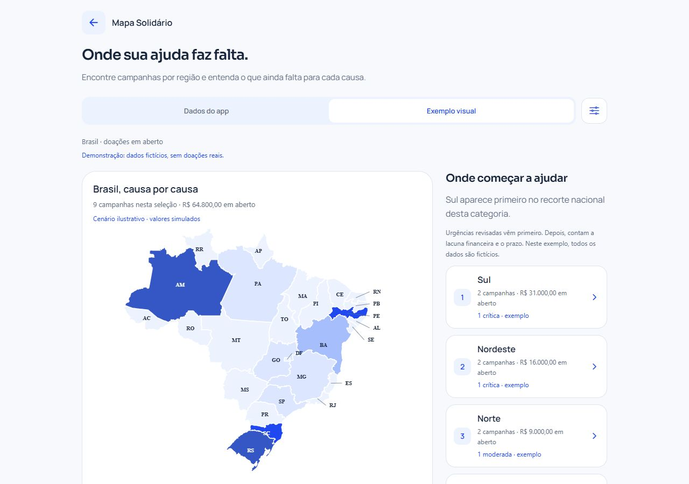
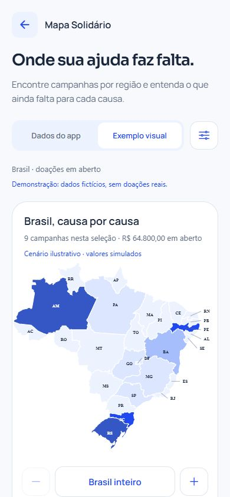

# Mapa regional em azul

## Direção anterior à implementação

Pedido: trabalhar melhor o mapa, mostrar regiões com maior demanda por doação e substituir Ana por João. Mantêm-se Manrope/Sora e a paleta aprovada: azul royal #1748F5, azul profundo #153A99, fundo #F7F9FC, superfície #FFFFFF e texto #17243B. O mapa é a figura principal; ao lado no desktop e abaixo no celular fica um ranking com nomes, valores e critérios, para não depender da cor ou do tamanho territorial.

A consulta local estava sem campanhas com consentimento para localização. O estado vazio será explícito. Um modo de demonstração voluntário usa dados fictícios, sem persistência ou ligação com receitas e campanhas reais. Não se atribui consentimento ou urgência a contas existentes.

A cartografia do IBGE já empacotada será preservada. Os estados terão níveis em azul, legenda textual e seleção por lista. Regiões e categorias filtrarão mapa e lista juntos. O indicador mantém os pesos existentes de revisão/lacuna/prazo, com urgências críticas e moderadas revisadas antes dos demais pedidos no ranking. Valores altos não concedem uma classificação de urgência.

O nome do cadastro de exemplo ana@exemplo.com será João em bancos novos e nesta instalação, mantendo identidade, e-mail, sessão e histórico. Outros cadastros não serão renomeados.

## Implementação e critérios

- `src/screens/mapa.tsx`: mapa em azul com legenda, chamadas externas para UFs pequenas, ranking regional e filtros por região, categoria e doações em aberto/todas as ajudas. Selecionar uma UF abre uma janela com valores e campanhas; a campanha verdadeira continua abrindo sua página. Zoom, arraste opcional, setas e centralização permanecem disponíveis.
- `src/data/prioridade-mapa.ts`: agregação somente de leitura. Conta urgências críticas revisadas antes das moderadas; desempata pelo indicador de urgência, lacuna e prazo já adotado pelo mapa. Lacuna alta sozinha não vira urgência. O grupo de maior lacuna usa a mediana dos valores estaduais em aberto, incluindo empates. A escala se mantém ao filtrar uma região.
- `src/data/mapa-demonstracao.ts`: nove registros fictícios, isolados da API e identificados no topo, no mapa, nas prioridades e nas campanhas. Não há botão de doação para esses registros. O modo padrão continua usando os dados do aplicativo.
- `backend/banco.js`: novo nome do cadastro inicial, João. A conta local correspondente foi atualizada de forma pontual, sem alterar a credencial ou outros usuários. Instalações existentes com nomes personalizados não são sobrescritas.

O mapa não mede pobreza, população, desastres ou necessidade social de todos os habitantes. Mostra campanhas ativas que autorizaram UF/município. Uma região sem dados pode precisar de ajuda e não ter usuários cadastrados. Nenhuma localização ou classificação de urgência real foi criada para preencher a tela. O banco principal continua sem localizações autorizadas; a prévia ilustrativa fica disponível pelo botão Exemplo visual.

## Verificações

- Quatro testes em `npm run testar:mapa`: prioridade revisada antes de valor alto, ausência de prioridade por declaração, diferença entre registros ausentes e demanda menor, filtro de doações/objetos/metas atingidas, UFs desconhecidas, prazo e ausência de mutação dos dados.
- 46 testes do backend com MySQL local aprovados, cobrindo preservação e permissões. Os testes usam bancos descartáveis separados.
- TypeScript, lint e exportação web verificados; exportações Android/iOS também geradas. Não equivale a teste em aparelho físico.
- Navegador com campanha fictícia autorizada em Santa Catarina: seleção da região, seleção da UF e abertura da campanha correta. A janela do mapa fecha antes da navegação. O cenário ilustrativo não permite abrir uma campanha falsa.
- Filtros combinados Nordeste + Saúde, zoom, seleção direta no desenho e setas de movimentação verificados. Comparação em 320, 360, 390 e 430 pixels: dados do app, exemplo visual e janela de UF sem transbordamento horizontal.
- Também verificados 375 px, orientação horizontal de 844 × 390 e os temas claro/escuro. As UFs pequenas têm chamadas externas, e o azul intermediário escuro foi ajustado para contraste de texto superior a 4,5:1. Testes com leitor de tela e aparelhos físicos continuam pendentes.
- Consulta pública da biblioteca confirmou responsável João e preservou o valor recebido, R$ 1.270,00. Não houve mudança em consentimentos, urgência, saldos ou regras do fundo.

