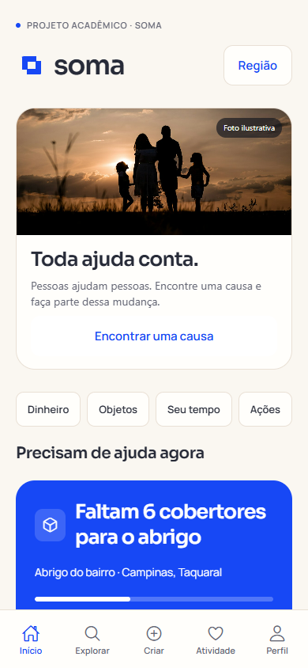
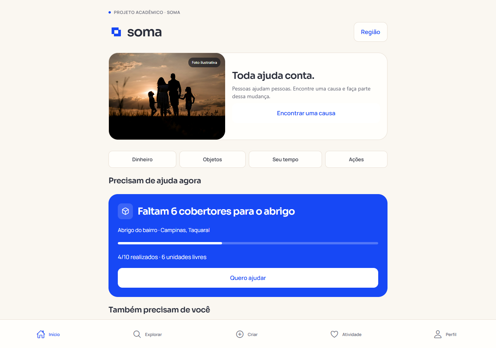
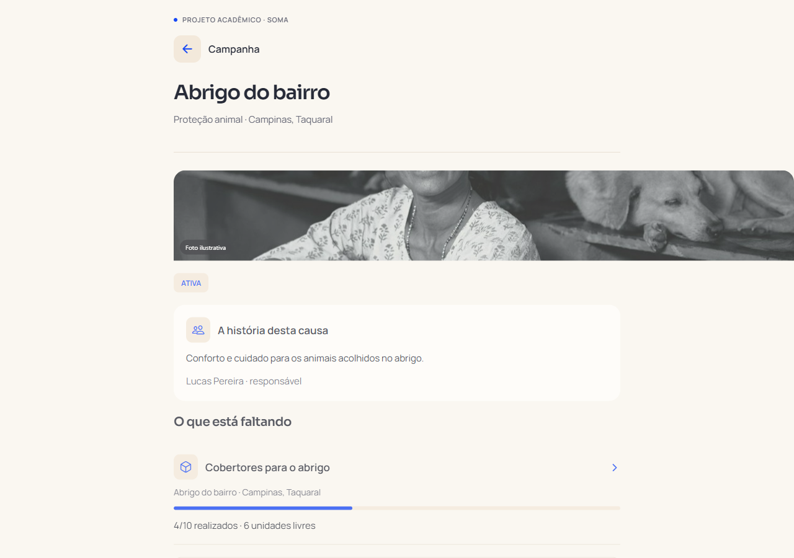
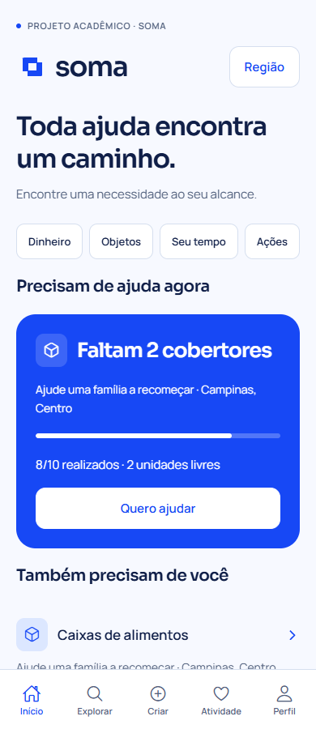
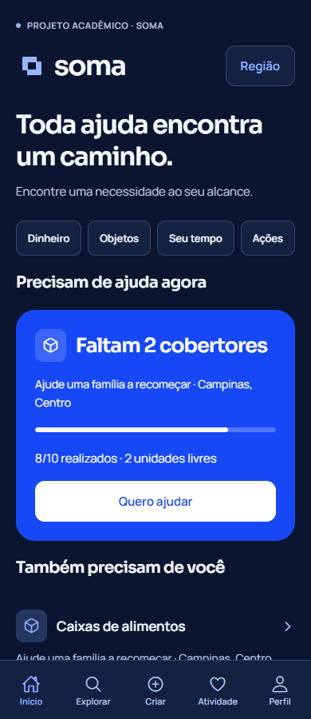
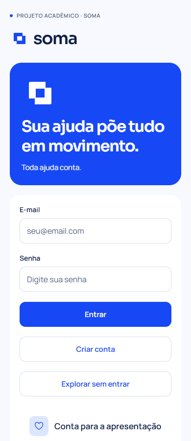

# SOMA — Enlace e azul royal

O usuário aprovou o conceito Enlace com azul royal após comparar três marcas e duas rodadas de paletas. O contexto é o SOMA solidário: campanhas, objetos, contribuições financeiras simuladas, tarefas e voluntariado. O aplicativo mantém 35 rotas, cinco abas, permissões, contratos da API e esquema MySQL. A revisão JF melhora as consultas após as ações e o cache/MIME das imagens no servidor; os detalhes estão em [REPAGINACAO-JF.md](REPAGINACAO-JF.md).

## Identidade e aplicações

O símbolo reúne dois módulos complementares: necessidade e contribuição se encontram. A mesma geometria de 100 unidades aparece no componente nativo, nos vetores e nas imagens de ícone/splash. O sinal funciona sozinho no ícone; a assinatura usa “soma” em minúsculas.

| Papel | Tema claro | Tema escuro |
| --- | --- | --- |
| Azul principal / destaque | #1748F5 | #1748F5 |
| Ação sobre superfície | #1748F5 | #97B5FF |
| Texto principal | #272B38 | #F7F4EE |
| Fundo | #FAF7F1 | #171923 |
| Superfície | #FFFEFB | #222532 |
| Texto secundário | #656775 | #C1BEBA |
| Apoio neutro | #F3E9DB | #34313A |
| Apoio comunitário | #E8EFE7 | #283A30 |
| Terracota / categoria | #A7442A | #F1A184 |
| Divisor | #E9E0D5 | #41414A |

O azul intenso concentra as ações e a marca; as histórias e fotografias vêm antes das metas numéricas. Branco sobre royal tem contraste 6,40:1; no tema escuro, as ações sobre superfícies usam azul claro com texto profundo. Erros têm mensagem, ícone e cor próprios. Contraste de paleta não equivale a certificação integral de acessibilidade.

Sora 600 nos títulos e assinatura; Manrope 400/600 em leitura e controles. Três TTF locais somam aproximadamente 236 kB e estão acompanhados das licenças SIL OFL. Fonte do sistema como alternativa em caso de falha. Não há serviço externo de fontes. A persistência nativa da aparência utiliza [AsyncStorage 2.2.0, compatível com Expo SDK 54](https://docs.expo.dev/versions/v54.0.0/sdk/async-storage/).

Vetores e imagens: `assets/brand/`. Os assets originais da base continuam em `assets/images/`. Configuração Expo atualizada para ícone, favicon, adaptive icon e splash. Para regenerar os PNGs/vetores, execute `python scripts/gerar-marca.py` com Pillow instalado; Python/Pillow são ferramentas de exportação, não dependências do aplicativo.

## Composição das telas

- Início: capa fotográfica com CTA, atalhos para doação, voluntariado, eventos e criação, histórias de campanhas e necessidades em cartões claros. Os dados vêm da API; disponibilidade desconta reservas, preservando a diferença entre reservado e realizado.
- Explorar: campanhas, necessidades, voluntariado e eventos em listas virtualizadas, com busca, região, categoria e recuperação de busca vazia.
- Entrada: marca em superfície suave e formulário separado. O login devolve a pessoa ao fluxo de ajuda que estava usando.
- Criação/contribuição: formulários agrupados em superfície de leitura, campos com foco visível, etapas textuais e quatro segmentos de progresso na criação.
- Campanha/necessidade: fotografia, história, formas de ajudar, organizador e transparência. Metas e disponibilidade ficam no contexto da necessidade. Sem indicadores de impacto inventados.
- Gestão/atividade/administração: agrupamentos por assunto e listas para reduzir a repetição de cartões.
- Saldo: valor disponível em destaque, estados financeiros alinhados e rótulos de simulação mantidos.
- Todas as rotas: tipografia, botões, avisos, modais, navegação e temas compartilhados. Áreas seguras e comportamento de teclado considerados nos formulários.

## Movimento e acessibilidade

Preferência de movimento reduzido lida no sistema e acompanhada durante a sessão. O padrão inicial é estático até conhecer a preferência. Sem introdução ou deslocamento quando ela está ativa; diálogos sem animação.

Splash nativa estática com o símbolo real. Carrega apenas as fontes locais indispensáveis; erro ou limite de 3 s libera a interface com a fonte do sistema. Após a interface ficar pronta, a introdução dura 1,8 s e ocorre uma vez por inicialização: a marca original aparece por 250 ms, os dois L deslizam em sentidos opostos por 850 ms até se unirem em um sinal de mais, o sinal permanece por 400 ms e a camada desaparece em 300 ms. A camada não captura toques e desaparece ao navegar, sem aguardar API ou banco. Não repete ao trocar abas.

Conteúdo entra com deslocamento de 8 pontos em 220 ms. Pressão dos botões usa escala 0,98 em 120 ms; resposta depende da preferência do sistema. Navegação nativa respeita avançar/voltar, com transição desativada em movimento reduzido. Progresso e estados incluem informação textual; controles têm rótulos acessíveis e alvos de pelo menos 44 pontos. Reutiliza Animated, Expo Font, Splash Screen e Ionicons já instalados.

Na revisão JF, a entrada acontece também ao voltar a uma tela. Abas usam fade de 180 ms; cartões e filtros compartilham a resposta de pressão dos botões. Modais e avisos usam entrada curta com escala de 0,98; a troca de tema usa fade de 180 ms. Todos esses movimentos são desativados em redução de movimento. Não foi introduzida uma biblioteca de animação ou navegação.

## Pesquisa que orientou a direção

[Pinterest — Charity Mobile App](https://in.pinterest.com/pin/charity-mobile-app--311029918012915666/) e [Donation App](https://ph.pinterest.com/pin/611926668151157131/) iniciaram a curadoria do setor. Os pins foram encontrados por indexação; o acesso integral foi limitado. [Airatae no Behance](https://www.behance.net/gallery/164519905/Corporate-Brand-Identity-Website-for-a-Non-Profit?locale=en_US) e [caso da agência](https://dd.nyc/work/airatae-non-profit-tech-platform/) orientaram a coerência entre identidade e comunidade. [Charity App no Dribbble](https://dribbble.com/shots/22103257-Charity-App-UI-Ux) e [Donation Charity App](https://dribbble.com/shots/14962021-Donation-Charity-App-full) ajudaram a comparar causa, ação e hierarquia móvel.

[Mobbin](https://mobbin.com/) foi referência complementar da galeria pública; fluxos protegidos por conta não foram auditados. O [índice histórico do Awwwards](https://www.awwwards.com/blog/?page=10&tag=inspiration&text=identity-design) foi consultado como levantamento, sem atribuir a ele tendências atuais. Os símbolos são desenhos independentes desta proposta, sem copiar marcas dessas referências.

APIs conferidas para o SDK 54: [Expo Font](https://docs.expo.dev/versions/v54.0.0/sdk/font/) e [Splash Screen](https://docs.expo.dev/versions/v54.0.0/sdk/splash-screen/).

## Validação

TypeScript, lint e exportação web passaram. Bundles Hermes de Android (1.087 módulos) e iOS (1.091 módulos) foram exportados; isso verifica a compilação JavaScript, não representa APK/IPA nem teste em aparelho. A splash e as áreas seguras nativas ainda precisam de revisão em build de dispositivo.

A primeira tentativa de regressão real encontrou `ECONNREFUSED 127.0.0.1:3306` porque o Docker Desktop não iniciava. A validação foi concluída depois com MySQL 8.4.8 próprio do projeto na porta 3307: os **8 testes de backend passaram**, incluindo persistência após reiniciar a API. Cadastro, criação em quatro etapas, atualização, perfil e logout também passaram pelas telas com a API real. A persistência foi conferida novamente após parar e iniciar o próprio MySQL. Veja [VALIDACAO-MYSQL.md](VALIDACAO-MYSQL.md) e [WINDOWS.md](WINDOWS.md).

A validação no Edge utilizou respostas controladas da API para verificar a interface independentemente dessa falha de infraestrutura. Ela não substitui o teste Node/MySQL nem comprova persistência real. Resultado: 35 rotas como visitante e administrador (70 verificações), mais 56 combinações de telas representativas/tema/largura, totalizando 126 verificações de layout. Temas claro e escuro em 320, 390, 768 e 1.280 pixels sem transbordamento horizontal; nenhum erro JavaScript de página.

Login/navegação, busca e filtro de região, reserva/cancelamento, pagamento/status, quatro etapas de criação, dados enviados à API, perfil/logout e introdução com/sem movimento reduzido passaram com as respostas controladas. A camada de introdução foi verificada sem captura de eventos e termina automaticamente. Resultados detalhados: [VALIDACAO-REDESIGN.json](VALIDACAO-REDESIGN.json).

Uma checagem adicional do build final confirmou que reservas não reduzem a quantidade ainda faltante na meta, mas reduzem as unidades livres para contribuir. Os estados sem pedidos e com erro de conexão também foram conferidos em 320 pixels, sem destaque inventado, transbordamento ou erro JavaScript.

## Humanização visual — 13/10/2026

A home agora combina a assinatura Enlace com uma imagem editorial e o destaque “Toda ajuda conta”, acompanhado de contexto e acesso direto à busca. As campanhas têm cartões com hierarquia editorial, resumo da causa, categoria e um convite para ajudar. A foto acompanha a categoria de cada campanha disponível: família, educação, proteção animal ou ação comunitária. Voluntariado e eventos mostram ações de apoio. As fotografias ficam no pacote local do aplicativo; não dependem de baixar imagens ao abrir cada tela. Cada foto tem rótulo e texto acessível que esclarecem seu uso ilustrativo e que não retrata os participantes daquela campanha. Títulos, regiões, necessidades, instruções, eventos e demais informações continuam vindo dos registros existentes; nenhuma campanha ou métrica foi criada.

O azul royal da marca permanece nos sinais e nas ações principais. Fundos, superfícies, divisores e tons de apoio foram aquecidos com papel creme, tinta grafite e apoio terracota, mantendo uma versão escura coerente.

Fotos ilustrativas usadas, marcadas como gratuitas para uso sob a licença Unsplash nas páginas consultadas:

- Família reunida ao entardecer — Tá Focando. [Foto e licença](https://unsplash.com/photos/a-family-standing-in-a-field-at-sunset-LOuffSFpWQI).
- Voluntários organizando doações — Joel Muniz, “Community Power”. [Foto e licença](https://unsplash.com/photos/volunteers-sorting-canned-food-donations-3k3l2brxmwQ).
- Crianças e livros — Annie Spratt. [Foto e licença](https://unsplash.com/photos/a-group-of-children-standing-in-front-of-a-bookshelf-Pw0vMMWnSWU).
- Cuidadora e cães — Anil Reddy; o retrato é de uma voluntária na Índia, não de participante do SOMA. [Foto e licença](https://unsplash.com/photos/woman-sitting-with-dogs-in-a-shelter-rG-NkySqeYI).
- A [licença Unsplash](https://unsplash.com/license) permite usar, copiar e adaptar gratuitamente as imagens, inclusive em projetos comerciais; o crédito não é obrigatório, mas foi registrado aqui para transparência.

Capturas da validação local feitas em 13/10/2026, com a home em 390 e 1.280 pixels e uma campanha real de desenvolvimento. As fotografias seguem identificadas como ilustrativas.

Capturas de exemplo com dados controlados, na largura de 390 pixels:

