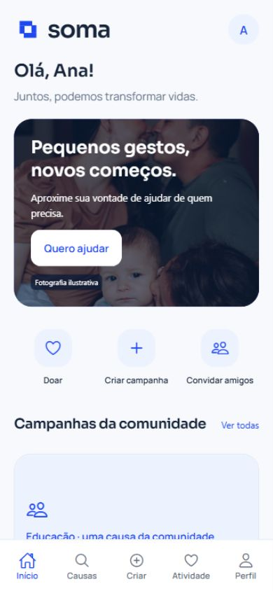
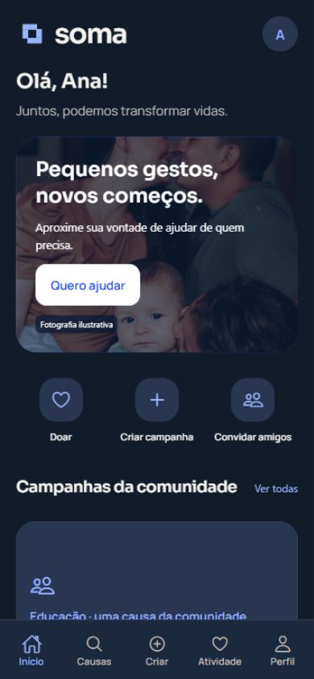
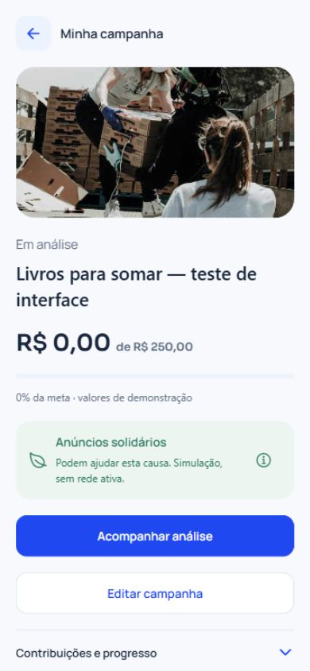
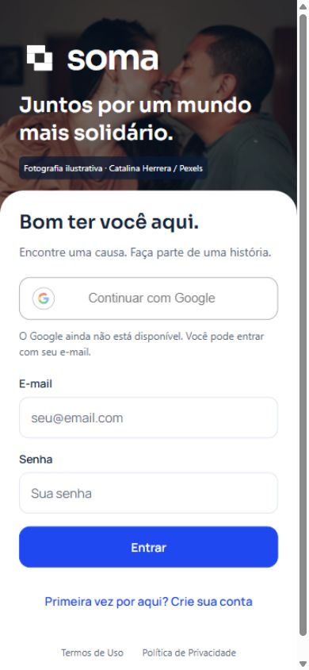

# SOMA — Reformulação humana em azul

Entrega de 26/10/2026 sobre a main 7e44b02. A instrução do usuário mantém o azul como identidade principal, substituindo a indicação de verde do briefing. O [plano e a auditoria anteriores ao código](REFORMULACAO-AZUL-PLANO.md) registram as decisões.

## Resultado

- Entrada com fotografia ilustrativa, marca, propósito e acesso por e-mail. Google oficial aparece indisponível enquanto faltar configuração. Termos e privacidade têm páginas próprias.
- Primeiro acesso pede nome e cidade opcional; foto é opcional. Perfil começa privado, sem declaração automática de maioridade. Foto Google depende de identidade validada, URL oficial e autorização de uso.
- Home com saudação real, fotografia, três ações e campanhas existentes. Lista pesquisável, cartões com valores do banco e detalhe priorizando história e contribuição. Filtros avançados, objetos, voluntariado, eventos e mapa continuam acessíveis.
- Criação financeira em quatro passos: história, foto/documentos privados, meta e revisão. Voltar conserva o formulário. Rascunho e publicação após análise humana continuam separados; reenvios usam identificação de operação para evitar duplicação.
- Doação simulada reúne valor, revisão e confirmação. Não pede um meio de pagamento real; usa o rótulo Simulação, com confirmação única e atualização do progresso independente da necessidade.
- Gestão com arrecadação, pequeno cartão verde de anúncios e ferramentas por abertura explícita. Doações, anúncios atribuídos e hipóteses ficam separados. A regra de 70/30 e a distribuição auditável foram preservadas.
- Perfil com dados, campanhas, participações, compartilhamentos, convite, privacidade, aparência, ajuda e saída. Compartilhar usa o dispositivo; quando bloqueado, oferece um endereço selecionável. Não confirma destinatários nem garante receita.
- Acompanhamento em trilha 2D. Componentes da estrada, Three.js, tipos, expo-audio, vinheta e acionadores foram removidos. /rota e /rota-inteligente continuam compatíveis. A abertura usa apenas uma marca estática durante carregamento.

## Sessão e preservação

A web usa cookie HttpOnly, SameSite=Lax, limitado a /api e até 24 horas. O servidor valida a sessão a cada acesso privado. A saída invalida a credencial e remove o cookie. A restauração não depende de token persistido em JavaScript; sessões web antigas em sessionStorage podem ser migradas uma vez. No nativo permanece o SecureStore. Mutações com cookie exigem JSON e origem autorizada. Em HTTPS atrás de proxy, configure COOKIE_SEGURO=1; não exponha a instalação de desenvolvimento como produção.

A migração aditiva 004-experiencia-humana acrescenta conclusão do primeiro perfil, foto Google opcional, registros privados de compartilhamento e o meio Simulação. Não apaga tabelas, contas, campanhas, documentos ou lançamentos anteriores. Perfis existentes não são forçados a repetir o primeiro acesso. Reiniciar não marca novos perfis incompletos como concluídos.

Comparação do banco local original antes/depois da atualização: 5 usuários, 3 campanhas, 6 necessidades, 2 ajudas e 2 atualizações preservados; nenhum pagamento ou repasse inserido pelos testes. Metas financeiras continuam em 200.000 centavos e recebido em 125.000 centavos. Jornadas com novos usuários e doações ocorreram exclusivamente em bancos descartáveis separados.

## Principais arquivos

| Área | Arquivos |
| --- | --- |
| Marca, paleta e componentes | src/design/theme.tsx, brand.tsx; src/components/ui.tsx, campanhas.tsx, fotos.tsx, solidariedade.tsx |
| Entrada e sessão | src/screens/boas-vindas.tsx; src/components/google-acesso.tsx; src/servicos/api.ts, acesso.ts; backend/sessao-web.js, google.js |
| Home, lista e história | src/screens/inicio.tsx, campanhas-lista.tsx, campanha.tsx |
| Criação e gestão | src/screens/criacao-simples.tsx, preparacao.tsx, gerenciamento.tsx |
| Doação, perfil e progresso | src/screens/doacao-simples.tsx, comunidade.tsx, perfil-social.tsx, rota.tsx |
| Compartilhamento e migração | src/servicos/compartilhar.ts; backend/experiencia.js, migrar-soma2.js, esquema.sql, soma2.js |
| Navegação e web | app/(tabs)/_layout.tsx, app/_layout.tsx, public/index.html e novas rotas de perfil/ajuda |
| Verificação | backend/testes-soma2.test.js, experiencia.test.js e suítes existentes |

## Validação executada

- TypeScript e lint Expo sem erros ou avisos. Dependências compatíveis com Expo 54 verificadas por expo install --check.
- 46 testes da suíte de backend com MySQL local, 4 de regras legadas e 3 de experiência: **53 aprovados**. Incluem permissões, concorrência, confirmação única, reenvio de documentos, fundo 70/30, privacidade, migração, restauração por cookie, CSRF, saída e perfil novo.
- Exportação web, Android e iOS concluída. Exportar bundles nativos não equivale a instalar/testar em aparelho físico.
- Navegador: login por senha, complemento de perfil, home, lista/detalhe, doação simulada de R$ 20 refletida na meta, foto escolhida no formulário, quatro passos, retorno sem perda da história, envio para análise, gestão, edição de dados, restauração em nova aba e alternativa ao compartilhamento bloqueado.
- 21 telas principais em 320, 360, 390 e 430 pixels: **84 verificações de geometria**, sem rolagem horizontal ou elementos ultrapassando a largura. Abrangem home, campanhas, detalhe, doação, criação, perfil, gestão, rota, convite, configurações, campanhas próprias, dados, compartilhamentos, personalização, preparação, urgência, mapa, descoberta, privacidade, termos e ajuda. Capturas visuais complementam a medição; ela não certifica acessibilidade completa.
- Temas claro e escuro inspecionados. Foco visível web, nomes acessíveis das abas, campos rotulados, retorno/fechamento de modais, redução de movimento do sistema e áreas seguras preservados. Textos sobre fotografias receberam proteção de contraste.
- Verificada ausência de áudio/canvas nas telas medidas e de imports/dependências exclusivas de áudio/3D no código ativo. O bundle web não contém o antigo recurso da estrada ou a vinheta.
- Auditoria de dependências de execução mantém 8 alertas transitivos (3 moderados, 5 altos, nenhum crítico). Não foi aplicada atualização forçada incompatível com o Expo.

## Pendências e limites

Google real depende de Client ID, Client Secret, redirect URI e consentimento no Google Cloud. Os segredos ficam somente no backend; o botão não usa credenciais fictícias. **A autenticação Google com uma conta real não foi testada.** Cancelamento e erros retornam à entrada com mensagem; vinculação continua disponível no perfil quando configurada.

Para habilitar na web local: no Google Cloud, configure a tela de consentimento, os escopos OpenID/e-mail/perfil e os usuários de teste; crie um cliente OAuth do tipo Aplicativo da Web. Autorize a origem http://localhost:3001 e a URI exata http://localhost:3001/api/auth/google/callback. Preencha GOOGLE_CLIENT_ID, GOOGLE_CLIENT_SECRET e GOOGLE_REDIRECT_URI somente em backend/.env e reinicie o servidor. Use o mesmo hostname em todo o fluxo. Em produção, substitua por domínio HTTPS autorizado e configure COOKIE_SEGURO=1. A web deve usar front e backend na mesma origem ou configuração compatível de cookies/CORS. O Google nativo ainda depende de integração e clientes próprios; Android/iOS usam e-mail e senha nesta entrega.

Não há provedor de pagamentos, rede publicitária, aplicações financeiras, recuperação automática por e-mail ou canal público de suporte configurado. Doações, anúncios e repasses são demonstrações. Projeções continuam indisponíveis sem o histórico mínimo; urgência continua sujeita à análise humana.

Compartilhamento depende do navegador/dispositivo. A alternativa por endereço foi verificada no navegador, que não concluiu a janela nativa; não foi enviada mensagem a terceiros. Links localhost só são úteis no próprio computador; distribuição externa requer endereço acessível ou instalação do aplicativo com seu esquema soma://.

Testes em dispositivos físicos, teclado virtual nativo, leitores de tela e maior tamanho de texto do sistema continuam pendentes. Não houve deploy público.

## Referências e imagens

As duas referências enviadas pelo usuário orientaram fotografia, hierarquia e agrupamento, preservando a identidade azul. [GoFundMe — como funciona](https://www.gofundme.com/c/how-it-works) foi consultado para organização de história/foto/compartilhamento. O botão usa a [marca oficial Google](https://developers.google.com/identity/branding-guidelines).

A imagem de entrada/home é de Catalina Herrera: [Happy Family with Two Children, Pexels](https://www.pexels.com/photo/happy-family-with-two-children-20194638/), sob a [licença Pexels](https://www.pexels.com/license/). É ilustrativa, não retrata beneficiários cadastrados nem implica endosso. Imagens anteriores mantêm os créditos em [REDESIGN.md](REDESIGN.md).

Capturas abaixo usam conta e campanha fictícias em banco separado; não representam atividade real.

