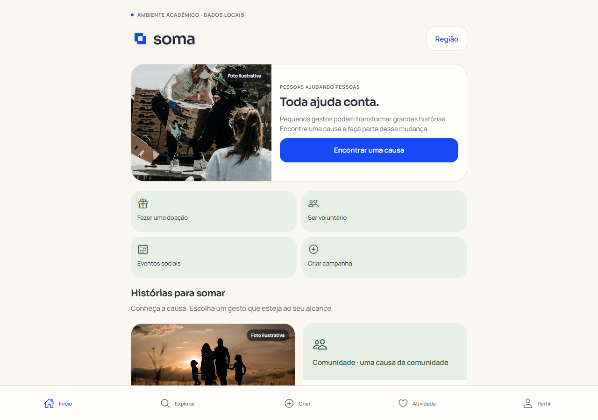
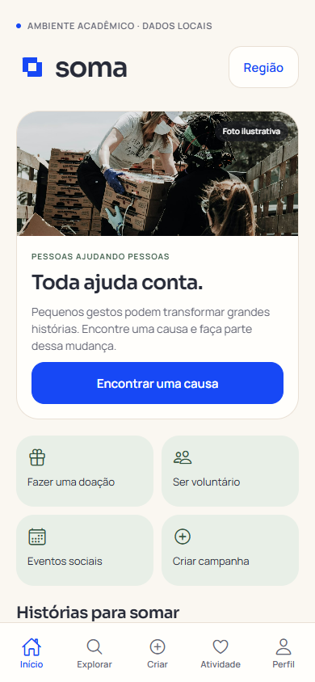
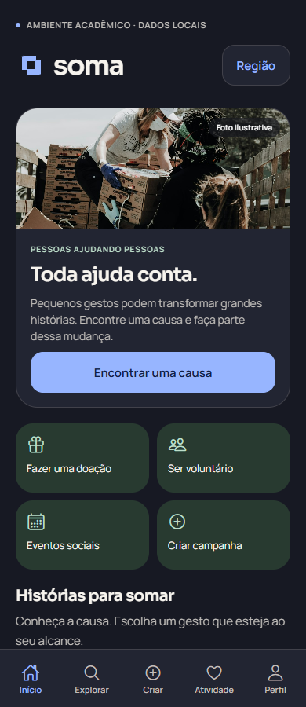
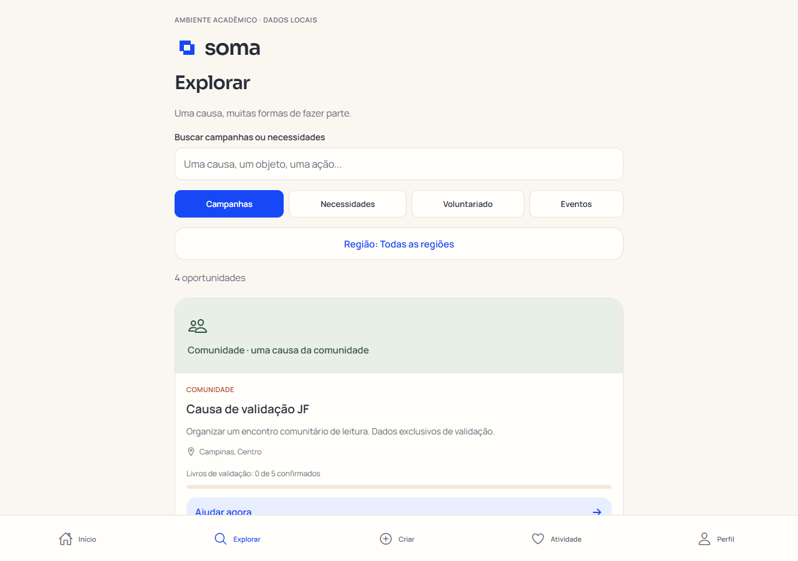
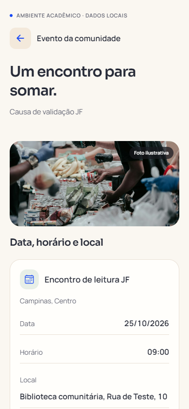

# SOMA — repaginação solidária e validação JF

Atualização de 13/10/2026 sobre a base integrada do SOMA. O produto continua sendo a plataforma acadêmica de campanhas solidárias, necessidades, voluntariado e eventos. A identidade Enlace e o azul royal `#1748F5` foram preservados.

## O que mudou

- **Início e descoberta:** chamada “Toda ajuda conta.”, capa com fotografia editorial, ações para encontrar uma causa, doar, ser voluntário, participar de eventos e criar campanha. As histórias precedem os números. Busca e filtros por tipo, categoria e região usam os registros da API; o estado vazio oferece retorno à lista.
- **Campanhas e contribuição:** cartões com contexto da causa, região, imagem ilustrativa e ação clara. A necessidade mostra a disponibilidade real, descontadas as reservas. Criação em quatro etapas, reservas, cancelamentos, confirmações e histórico continuam gravados no MySQL. Ajuda financeira permanece uma simulação acadêmica sem cobrança.
- **Voluntariado e eventos:** detalhes públicos, autenticação que devolve à oportunidade selecionada, inscrição persistida e histórico na área da pessoa. Novos eventos registram separadamente nome, data, horário e local; o formato anterior continua legível. Datas impossíveis são rejeitadas.
- **Aparência:** temas Claro, Escuro e Sistema no perfil, com preferência salva no dispositivo. Na web, a cor inicial é aplicada antes do carregamento do bundle para evitar o flash do tema errado. Superfícies quentes e tons verdes de apoio acompanham a marca azul.
- **Movimento:** resposta de pressão, entrada curta do conteúdo, navegação e troca de tema. A preferência do sistema por movimento reduzido desativa essas transições. A introdução da marca não bloqueia a interface.
- **Interface compartilhada:** avisos, cartões, botões, estados de carregamento/erro/vazio, tipografia e controles receberam tratamento consistente. Fotografias são locais e têm descrição acessível. A foto de uma campanha é ilustrativa e não afirma retratar seus participantes; campanhas novas sem foto recebem uma capa gráfica neutra.

## Base preservada

Foram mantidos Expo Router, React Native, a API Node HTTP, o esquema MySQL e os contratos principais de campanhas, necessidades e participações. A dependência nova de execução é AsyncStorage 2.2.0, para a preferência de tema nativa; a versão é [compatível com Expo SDK 54](https://docs.expo.dev/versions/v54.0.0/sdk/async-storage/). A versão web usa `localStorage`. O servidor também entrega JPEG/WebP com MIME adequado e cache para arquivos com nome hash.

## Referências visuais e fotografia

A hierarquia de história, imagem e ação foi informada pelas páginas públicas de [GoFundMe](https://www.gofundme.com/), [charity: water](https://www.charitywater.org/) e [UNICEF](https://www.unicef.org/). A composição foi criada para o SOMA; não foram reproduzidos símbolos, campanhas ou números das referências.

A nova imagem da capa, com pessoas organizando caixas de alimentos, é de [Joel Muniz no Unsplash](https://unsplash.com/photos/A4Ax1ApccfA). Os créditos das quatro imagens anteriores estão em [REDESIGN.md](REDESIGN.md). Todas as imagens são ilustrativas, distribuídas com o aplicativo e usadas sob a [licença Unsplash](https://unsplash.com/license).

## Verificação

- TypeScript e ESLint passaram sem erros; a exportação web foi concluída.
- Bundles Hermes para Android (1.115 módulos) e iOS (1.113 módulos) foram exportados. Essa verificação cobre compilação JavaScript; não substitui um build instalado e observado em aparelho.
- Os oito testes existentes de backend passaram em MySQL local isolado, incluindo transações, cancelamento e persistência.
- Uma rodada no Edge com API e MySQL reais executou 16 fluxos funcionais, 70 verificações de rotas (35 como visitante e administrador) e 64 verificações de tela em 320, 390, 768 e 1.280 pixels, nos temas claro e escuro. Não houve transbordamento horizontal nem erros JavaScript de página. O banco temporário da rodada foi removido; os dados locais do SOMA não foram alterados. Resultados: [VALIDACAO-JF.json](VALIDACAO-JF.json).
- A preferência Sistema reagiu à mudança do sistema; a escolha manual persistiu após recarregar. Foram conferidos o fundo antes do bundle, a animação padrão e a redução de movimento. O retorno após login, a inscrição, o cancelamento e a leitura atualizada do MySQL também passaram.

## Prévia

Capturas do build local com dados acadêmicos de teste e fotografias identificadas como ilustrativas:

## Limites atuais

Contribuições financeiras são simulações acadêmicas, sem gateway de pagamento ou cobrança. Não há envio de foto própria para uma campanha; a capa neutra evita atribuir a ela uma foto de outra causa. A exportação nativa não equivale a teste de APK/IPA em aparelho. Os dados de impacto refletem confirmações registradas, sem auditoria externa.
