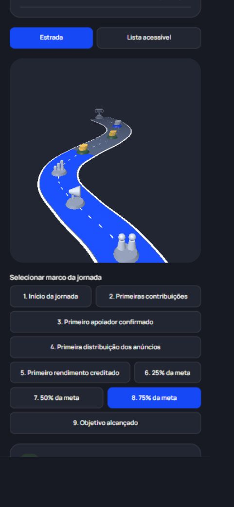
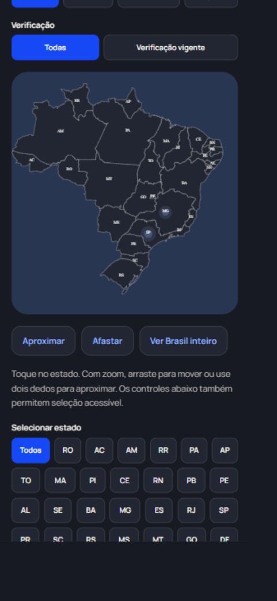

# Validação da atualização funcional — 23/10/2026

> Registro da versão 6d63efd e anteriores. A integração atual preserva a experiência descrita e atualiza os contratos de API, publicação, privacidade, urgência e conciliação: [guia SOMA 2.0](SOMA-2.md) e [validação atual](SOMA-2-VALIDACAO.md).

## Resultado

Validação em Windows, Node 24.11.1, npm 11.6.2 e MySQL 8.4.8. A instalação foi reproduzida com `npm ci --no-audit --no-fund`. O MySQL desta pasta foi inicializado separadamente na porta **3317**, com credenciais aleatórias ignoradas pelo Git, sem usar nem alterar os dados da outra cópia do projeto. O pacote oficial já disponível foi copiado e novamente verificado pelo SHA-256 antes da extração.

Nesta máquina, a prévia usa **http://localhost:3011** para evitar conflito com a outra cópia. O arquivo privado `backend/.env` configura banco 3317, porta 3011 e origem web correspondente. Para iniciar novamente: `npm run banco:local` e `npm run servidor`. Em outro computador, seguir a configuração padrão do README; os arquivos locais de banco/credenciais não são enviados ao GitHub. Se configurar Google nesta máquina, usar a porta 3011 na origem e no callback, em vez de 3001 no exemplo geral.

| Verificação | Resultado |
|---|---|
| Instalação a partir de `package-lock.json` | Aprovada |
| TypeScript, `npm run verificar:tipos` | Sem erros |
| `npm run lint` | Sem erros ou avisos |
| `npx expo install --check` | Dependências compatíveis com SDK 54 |
| `npm run testar:inteligencia` | 4 testes aprovados |
| `npm run testar:backend:local` | 14 testes aprovados, incluindo teste pai e 13 cenários |
| `npm run compilar:web` | Exportação aprovada |
| Exportação Android/Hermes | Aprovada, 1.258 módulos, pacote de aproximadamente 3,55 MB |
| Configuração Expo com plugins nativos | Introspecção concluída |
| Revisão de alterações e busca por padrões comuns de segredos | Sem segredos encontrados nas alterações versionadas |
| Arquivos de configuração e dados locais | Ignorados pelo Git |
| Auditoria npm | **8 alertas pendentes: 3 moderados e 5 altos; zero críticos** |

O total reportado pelos executores é de **18 testes aprovados** entre regras e integração. O banco de integração é temporário e separado de `soma`; a suíte também reinicia o Node e confere a persistência. O teste final foi executado com o MySQL próprio desta pasta usando o comando documentado, sem credenciais exibidas.

## O que os testes verificam

- Cadastro, senha, sessão expirada/revogada, SQL parametrizado, conta comum sem promoção administrativa e permissões do administrador.
- Criação/edição de campanhas, falhas com rollback, múltiplos pedidos independentes, encerramento, suspensão, reabertura e preservação de histórico.
- Concorrência na última unidade disponível, recebimento parcial, cancelamento, atualizações, avisos e privacidade das instruções de entrega.
- Confirmação financeira de teste única, limites de meta, repasses/reembolsos, idempotência concorrente e persistência.
- Regras de urgência, exigência de evidências/consistência, pontuação explicável e revisão humana registrada. Reenvio de solicitação pendente e repetição de decisão são recusados. Um recurso torna a prioridade anterior inválida até nova decisão.
- Rateio 70/30 com centavos inteiros, conservação do total, teto de 35%, recursos retidos, histórico de distribuição, prazo e ausência de elegíveis.
- Reenvio concorrente da mesma receita sem duplicação, referência duplicada recusada, anúncios separados do saldo sacável, pagamentos pendentes respeitados pelo rateio e pagamentos novos respeitando os anúncios. Redução de meta abaixo do total comprometido é recusada sem invalidar a revisão anterior, por rollback.
- Atualização do progresso, data do alcance dos novos marcos e apoiador efetivamente registrado. Marcos de anúncios/rendimentos não são concluídos sem o evento correspondente.
- Hipóteses financeiras inválidas rejeitadas e estimativas separadas da arrecadação. Imagens SVG, URLs externas, base64 com conteúdo incompatível e excesso de tamanho são recusados.
- Perfil e preferências privados, localização pública por UF, mapa sem instruções de entrega ou dados sensíveis, Google indisponível sem configuração e resgate de código inválido recusado.

## Conferência visual e uso no navegador

Navegador em tamanho desktop e viewport mobile solicitado de 390 × 844. Os controles responsivos e as consultas foram conferidos. Foi utilizado um banco visual descartável, com conta e localizações de teste; essa base foi encerrada/removida após a conferência. As imagens abaixo representam testes, não campanhas verificadas reais.

1. Login por senha, abertura do perfil, edição da biografia, gravação e recarregamento: sessão e biografia preservadas.
2. Mapa com 27 estados, círculos de campanhas de teste em SP/MG, seleção por controle acessível: São Paulo mostra as duas campanhas esperadas; Rio de Janeiro mostra estado vazio correspondente.
3. Rota com renderização 3D real, marcos concluídos/futuros e navegação pela lista. O toque diretamente no coração 3D mudou a seleção de Início para Primeiras contribuições e exibiu o valor de R$ 200.
4. Projeção sobre saldo de teste de R$ 1.250, com hipótese explícita de 0,8% no mês e anúncios de R$ 10: rendimento de R$ 10, anúncios de R$ 10 e total hipotético de R$ 1.270, sem alterar R$ 1.250 confirmados.

## Limitações e dependências externas

- **Google não foi validado com credenciais reais.** O fluxo web está implementado, mas aguarda cliente, segredo, origem, callback, consentimento e conta de teste do Google Cloud. OAuth nativo não foi implementado; o aplicativo nativo usa senha.
- Pagamentos, repasses e receita/distribuição de anúncios são simulações acadêmicas. Não existe provedor de pagamento ou rede publicitária conectado; nenhum dinheiro real é recebido, investido ou transferido.
- Rendimento efetivamente creditado permanece zero. A simulação não executa investimento. Cofre documental sensível, IA auxiliar e validação documental automática não estão integrados; a avaliação humana registra referências privadas.
- A exportação Android valida compilação, **não equivale a teste em celular físico, APK assinado ou publicação**. SecureStore, seletor de fotos, gestos multitouch e acessibilidade nativa precisam de teste em dispositivo. iOS não foi compilado nem executado. A alternativa nativa é 2,5D, não WebGL nativo.
- O seletor de imagens foi integrado e a validação de arquivos foi testada na API. Não foi realizado upload visual de uma foto pessoal durante esta conferência.
- Os 8 alertas npm restantes estão na cadeia `expo`/`@expo/cli`/`@expo/code-signing-certificates`/`node-forge`, `expo-router`/`query-string`/`decode-uri-component` e `image-size` usado pelo Metro. A auditoria **não está zerada**. A atualização compatível removeu os alertas críticos detectados inicialmente, mas não foi aplicada a migração incompatível sugerida pelo npm. Nenhum `--force` foi usado. A migração do Expo/roteamento e os alertas de ferramentas de imagens/assinatura precisam de revisão antes de produção.
- `.npmrc` fixa o modo de resolução de peers usado na instalação testada, evitando que peers opcionais do CLI tragam uma versão principal diferente do roteador. Há overrides conservadores de PostCSS e correções de brace-expansion/ws dentro de suas versões principais. A compatibilidade declarada do Expo foi conferida após a instalação limpa.

## Sincronização

Implementação preparada na branch temporária `atualizacao-funcional-soma`, a partir de `6bf9b56` da `main`, e incorporada por avanço direto à branch de desenvolvimento existente `mudancas-jf`. Commits de implementação: `bcb3dc8` (API/regras/OAuth), `3f5fa72` (rota/mapa/perfil) e `9ae8484` (marcos de apoio/permissões). A documentação e estas evidências entram em um commit separado. A integração de `mudancas-jf` à `main` mantém esses commits e o histórico anterior. O hash final e a confirmação do push são informados na entrega, após consulta ao remoto. Não houve deploy de produção.
